<h1>Hi, I'm Enderburstz 👋</h1>

I tinker sometimes. Independent dev from the Cayman Islands 🇰🇾

## Languages

        

## Frameworks and platforms

       

## Editors and tools

      

## Currently tinkering on

- A privacy-focused notes app
- A strata property management app

## When I'm not coding

Anime · music (anything but country) · hardware, back when it wasn't so damn expensive

## Projects

<a href="https://github.com/Enderburstz/PocketGPG">
<picture>
  <source media="(prefers-color-scheme: dark)" srcset="profile/pin-pocketgpg-dark.svg" />
  
</picture>
</a>

## Stats

<picture>
  <source media="(prefers-color-scheme: dark)" srcset="profile/stats-dark.svg" />
  
</picture>
<picture>
  <source media="(prefers-color-scheme: dark)" srcset="profile/top-langs-dark.svg" />
  
</picture>

<picture>
  <source media="(prefers-color-scheme: dark)" srcset="https://streak-stats.demolab.com?user=Enderburstz&hide_border=true&theme=github-dark-blue&background=0D1117" />
  
</picture>

## Contribution snake

<picture>
  <source media="(prefers-color-scheme: dark)" srcset="profile/snake-dark.svg" />
  
</picture>

## Shout-outs

Open-source, self-hostable alternative to Heroku and Vercel. I self-host it to run my apps, and it's been great.
